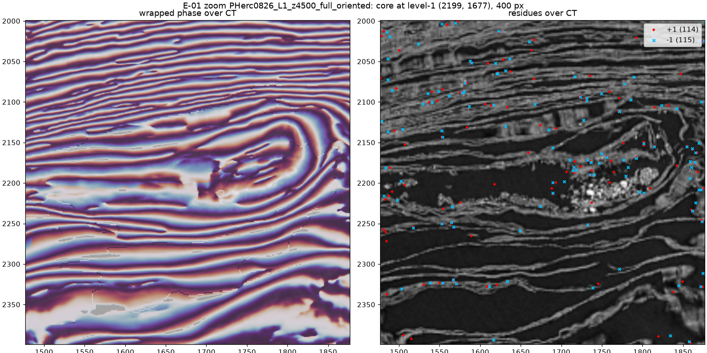
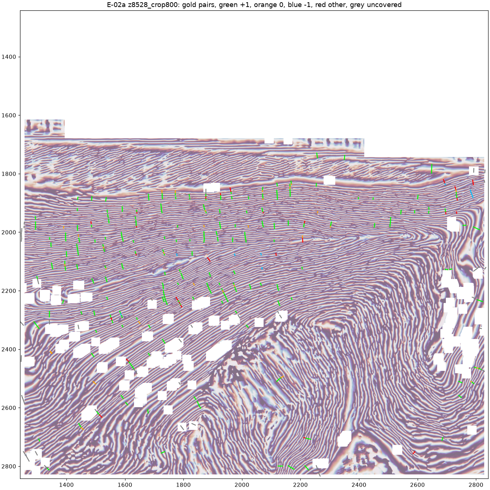
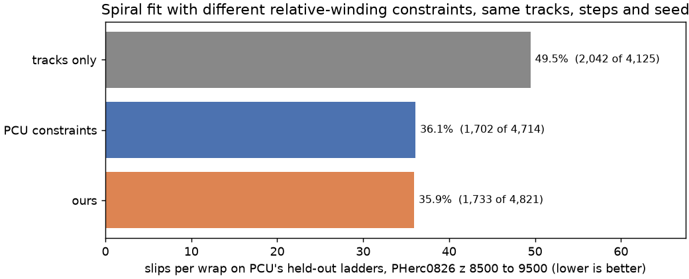

# winding-phase

**Can Lasagna's cosine channel be treated as a wrapped phase and unwrapped, InSAR style, into winding constraints for the villa spiral fitter?**

Status, 2026-10-24. Relative-winding constraints generated from one Lasagna run were fed to villa's spiral fitter on three scrolls, each time against PCU's published constraint set under the same fitter and scoring. On PCU's held-out ladders, which come from the same Lasagna output as our constraints, ours lead on two eligible scrolls: PHerc0826 (z 8500 to 9500) 32.1% slips per wrap against 36.1% for PCU at its best and 49.5% with no constraints; PHerc0211 (z 9500 to 10500, nothing re-tuned) 24.9% against 30.1% for PCU and 40.1% with none. Those tests measure agreement with PCU's reading of Lasagna, not with the papyrus. On Paris 4, scored on 32 human-traced ladders, ours and PCU's cannot be told apart at the higher draw rate and strip weight (7.8% and 9.9% slips per wrap over two seeds, against 8.3% for PCU at the same setting and 20.1% with no constraints). At PCU's own settings ours does not help on human labels: it gets 60.4% of the 394 human pairs right, against 59.6% with no constraints and 71.6% with PCU's. A second Paris 4 band (z 11000 to 12000, 38 more human ladders) was then run under a decision rule fixed before the run. Pooled over both bands (70 ladders, 606 pairs), ours at the higher setting gets 70.1% of human pairs right against 56.8% with no constraints (+13.4, +8.0 to +18.3; second seed +13.0, +6.9 to +18.7), and 71.9% for PCU's set at the same setting (difference -1.8, -7.7 to +3.9). Ours improves the fit on human labels; it does not beat PCU's set there.

## What is here

| File | Does |
|---|---|
| `lasagna_store.py` | Reads the published Lasagna pyramids (cos, grad_mag, nx, ny) and the CT for one scroll from the open-data bucket, one slice window at a time; decodes the uint8 encodings |
| `phase.py` | Wrapped phase per slice: local contrast normalisation, Riesz-transform quadrature projected on the predicted normal, `atan2`; 2x2 loop residues |
| `umbilicus.py` | Outward reference direction from the hand-annotated umbilicus, used to orient the normals |
| `e01_residue_map.py` | One slice: three-panel figure (CT, wrapped phase, residues over CT) plus a JSON of the numbers |
| `e01_variants.py` | Same crop under three settings, to see what drives the residue count |
| `e01_residue_analysis.py` | Residue density by local fringe period and by distance from the umbilicus; dipole share |
| `e01_papyrus_split.py` | Residues on vs off papyrus, with the m7 surface prediction as the mask |
| `e01_zoom.py` | Zoomed windows at native pixels, residues over the CT |
| `e02a_baseline.py` | 2D unwrap of one held-out slice, scored on PCU's gold ladders |
| `e02a_gates.py` | Precision against coverage for three confidence gates |
| `e02a_failures.py` | Failing pairs drawn over the phase; failure rate by pair length and radius |
| `e02a_certify.py` | Ridge-count and density votes on 1-wrap pairs |
| `e02a_kwrap.py` | All votes and certificates on 1-, 2- and 3-wrap pairs (the scoreboard below) |
| `e02a_heldout8.py` | Pools the k-wrap scores over PCU's eight held-out slices |
| `e03_ladders.py` | Generates certified winding ladders on one slice (`--scroll` selects the scroll) |
| `e03_sign.py` | Orients each ladder by the winding gradient of a prior fit grid |
| `e03_merge_band.py` | Merges per-slice ladders into the fitter's `relative_windings.json` |
| `e03_split_gold.py` | Holds out every n-th slice of a PCU gold band for scoring |
| `e03_fit_pod.py` | Builds the fitter dataset on a GPU machine, runs the fits, runs PCU's eval |
| `e03_correct_of_all.py` | Runs PCU's `e31b_bootstrap.py` unchanged and adds correct pairs out of all pairs (unassigned counts as wrong), with paired intervals and per-ladder counts |
| `e03_pool_bands.py` | Pools correct pairs out of all pairs over several bands with a paired, band-stratified ladder bootstrap |
| `e03_figure.py` | Slips-per-wrap chart from the eval lines |

## Run

```
uv venv --python 3.12 .venv && uv pip install --python .venv/bin/python -r requirements.txt
.venv/bin/python e01_residue_map.py --z 2250 --crop 640 --level1 --orient --out out/
```

`--z` is a level-2 slice index (band z 8500 to 9492 at full resolution is 2125 to 2373). Omit `--crop` for the full slice. Reads stream from the bucket; a 640-pixel crop takes about 20 s, nothing is cached.

## What one slice says (PHerc0826, level-2 slice 2250, full slice at level 1)



*Core of the scroll at level 1 (18.7 µm per pixel): wrapped phase over the CT on the left, residues on the right. Fringes track every sheet; Lasagna continues them across air gaps by design; the one cluster of residues sits on the bright debris inside the core.*

**Phase reconstruction.** The stored cosine is never zero inside the scroll; it oscillates between about 0.65 and 0.98 from sheet to sheet. Taken as is, `arccos` never reaches pi, nothing wraps, and the residue map is blind. So: contrast-normalise per local window, then take the quadrature with a Riesz transform projected on the predicted normal and use `atan2`. Pointwise sign recovery from the cosine gradient was tried first and produced balanced plus/minus residue pairs everywhere; the Riesz transform removed that. After the fix, phase rises along the predicted normal on 95% of pixels at 0.67 rad per pixel (level 2).

**What drives the residue count** (640-pixel crop, `e01_variants.py`):

| Setting | Residues per 1,000 valid pixels | Dipole share (opposite sign within 2 px) |
|---|---|---|
| level 2, normals as stored | 12.7 | 0.52 |
| level 2, normals oriented outward from the umbilicus | 11.8 | 0.51 |
| level 1 cosine, normals oriented | 2.9 | 0.24 |

Resolution matters, orientation of the normals does not. At level 2 (37 µm per pixel) packed sheets are three pixels apart and half the residues are sampling noise. Level 1 is the working resolution from here on.

**Full slice at level 1** (`figures/e01_stats_*.json`, `e01_analysis_*.json`, `e01_papyrus_split_*.json`): 13,309 residues, 10,282 after eroding the valid mask 30 px to drop the border ring, 3.8 per 1,000 cells, dipole share 0.33.

| Test | Result |
|---|---|
| Density by local fringe period | 16 per 1,000 below 3 px (59% dipoles), 4 to 6 per 1,000 at 5 to 14 px, 1.3 per 1,000 above 40 px (26% dipoles) |
| Density by distance from the umbilicus | flat, 2.3 to 4.0 per 1,000 at every radius |
| On papyrus (within 3 px of the m7 surface prediction) vs off | 3.9 vs 3.7 per 1,000 |
| Gate on Lasagna's own grad_mag (0, 0.03, 0.06) | 3.1, 3.2, 3.4 per 1,000: no effect |
| Smoothing the cosine (sigma 0.7, 1.5, 2.5 px) | 3.1, 2.9, 2.7 per 1,000: not sub-pixel noise |
| Persistence to the slice 37 µm away (same sign within 2 px) | 40% of residues, against 2.5% for a shuffled control; 59% within 4 px |

**Reading.** The residues are not noise and not a border or mask effect: they persist along z and survive smoothing. But they do not localise on anything visible either. Their density is the same on and off papyrus, flat across the scroll, and independent of Lasagna's confidence. On this slice the field has a uniform background of fringe dislocations, about four per 1,000 cells, running through z. So the residue map on its own is not a missed-sheet detector here. For unwrapping that background is what a minimum-cost-flow solver has to route branch cuts around; whether the cuts land on real sheet ambiguities is a question for scoring against the PCU held-out ladders, not for this figure.

This first experiment covered one slice and no fit; the sections below take it to a fit.

## Scored against PCU's held-out ladders (E-02a, same day)

PCU publishes 3,426 gold ladders on eight held-out slices of PHerc0826 (`gold0826_heldout8.json`, SHA256 `edc56561...`): chains of points on consecutive sheets, level-0 coordinates, z 8528 to 9424 in steps of 128. Points one rung apart are a true 1-wrap pair; two and three rungs apart give true 2- and 3-wrap pairs, so the same slices carry negatives for the +1 test. All eight slices, full width, level 1: 11,463 pairs (6,628 one-wrap, 3,202 two-wrap, 1,633 three-wrap).

Three estimates of the winding difference per pair, each independent of the others:

- **unwrap**: wrapped phase as above, unwrapped in 2D with scikit-image (reliability sorting), difference between the two points rounded to windings;
- **ridges**: interior maxima of the smoothed cosine along the segment, plus one;
- **density**: Lasagna's grad_mag (windings per base voxel, base = level 1, decoded per the manifest) integrated along the segment, times a calibration of 1.23. The calibration was fitted once, on an 800-pixel crop of the first slice (one-wrap median integral 0.81), and applied to all eight unchanged; the per-slice one-wrap median runs from 0.78 to 0.82.

| Estimate | 1-wrap accuracy | 2-wrap | 3-wrap |
|---|---|---|---|
| unwrap (on its 83 to 86% covered pairs) | 80.5% | 70.5% | 61.3% |
| ridges | 73.0% | 82.7% | 87.8% |
| density | 100% | 92.6% | 82.2% |

Certificates, pooled over all 11,463 pairs of the eight slices, any k (counts summed, not rates averaged):

| Votes that must agree | Coverage | Precision of the agreed value |
|---|---|---|
| unwrap, ridges | 51% | 98.2% |
| unwrap, density | 63% | 98.7% |
| ridges, density (no unwrap needed) | **75%** | **99.0%** (8,561 of 8,650) |
| all three | 48% | **99.7%** (5,475 of 5,490) |
| PCU's own certificate, Paris 4, 1-wrap set | 70% | 99.6% |

Per slice (`figures/e02a_heldout8_pooled.json`, one JSON per slice beside it):

| z | pairs | all three | ridges, density |
|---|---|---|---|
| 8528 | 1,411 | 99.8% at 46% | 98.7% at 75% |
| 8656 | 1,338 | 99.4% at 46% | 98.0% at 77% |
| 8784 | 1,497 | 99.3% at 50% | 98.6% at 75% |
| 8912 | 1,595 | 100% at 49% | 99.3% at 74% |
| 9040 | 1,288 | 100% at 52% | 100% at 78% |
| 9168 | 1,258 | 100% at 48% | 99.5% at 78% |
| 9296 | 1,581 | 100% at 46% | 99.8% at 75% |
| 9424 | 1,495 | 99.3% at 47% | 97.9% at 74% |

The worst slice for the three-vote certificate is 99.3%; its coverage sits between 46% and 52% everywhere. The three-vote certificate misses 15 pairs in 5,490; all 15 are 3-wrap pairs on which the three estimates agree on a wrong count. On 1- and 2-wrap pairs it has no miss in 8 slices.

What the plain unwrap gets wrong: missed wraps (0) and reversed direction (-1) on the shortest pairs; not flagged by fractional phase error, amplitude, or distance to the nearest residue (`e02a_gates.py`), and only a few points sensitive to the contrast window and smoothing. Normals are an unoriented axis (villa Lasagna docs); they are oriented outward from the umbilicus here, interpolated as a structure tensor, and a zero grad_mag is treated as an invalid sample.



*One-wrap gold pairs over the wrapped phase, 800-pixel crop of z 8528: green +1 (right), orange 0 (missed wrap), blue -1 (reversed), red other, grey not covered by the unwrap.*

This section stops at the certificate; the fit follows below. Reproduce with `e02a_kwrap.py` per slice (flags in its docstring: window 30, smooth 0.3, prominence 0.08, base level 1, density scale 1.23) and `e02a_heldout8.py` to pool.

## From constraints to a fit (E-03)

The certificate above scores pairs that PCU chose. A constraint source has to choose its own. `e03_ladders.py` does that on one slice: seeds on cosine ridges (one per 16 px cell at level 1), a walk outward along the oriented normal to the next cosine ridge, and each hop certified as one winding by the integrated density (within 0.35 of 1.0, a band rather than rounding, because a half-spacing hop integrates to about 0.6 and would round to 1) and by the 2D unwrap. Hops chain into ladders with relative windings, written in PCU's gold format (point collections v1, level-0 coordinates), the format the villa fitter reads as `relative_windings.json`.

Scored by overlap with the gold: a gold pair whose two rungs both lie within 2.5 px of points of one of our ladders is a test, correct if the winding difference of that ladder matches. Eight held-out slices, 34,377 ladders, 78,398 one-wrap pairs, 2,235 tests (1 to 3 wraps):

| | Correct | Precision |
|---|---|---|
| winding count, sign ignored | 2,211 | 98.9% |
| count and sign, sign from the outward normal | 2,139 | 95.7% |
| count and sign, sign from a prior fit (PCU's tracks-only fit A0, winding gradient over 120 voxels) | 2,192 | 98.1% |

Without the unwrap vote the count drops to 99.2% on one slice (spurious cosine ridges that the density band lets through), so both votes stay. The sign is the finding: where a crushed sheet doubles back, the fitter's winding decreases outward, and no local measurement can tell (the normals are an unoriented axis, the cosine is a wrapped phase). On the first slice 53 of 820 gold one-wrap pairs run inward, and every sign error of the outward rule sits on them. `e03_sign.py` therefore reads the direction of increasing winding from a prior fit grid (`grids_<run>.npz` as PCU stacks them) and reverses the ladders that run against it. A 60-voxel radius leaves 96.9%, 120 and 200 give 98.1%, 300 gives 97.5%.

The band file for the fitter is built: z 8500 to 9492 every 16 (63 slices, PCU's spacing), 268,401 ladders, 881,629 points, 3.28 points per ladder (PCU's input: 25,771 ladders, 73,110 points on the same slices). Signs: 239,686 ladders along the A0 gradient, 19,867 reversed by it, 8,848 with no readable gradient kept outward (two thirds of those on the band's first slice, where the A0 grid has no row). `relative_windings.json`, 122 MB, SHA256 `3f9c41a6...`, built by `e03_ladders.py` on each slice (about 2.7 minutes per slice on an M4), `e03_sign.py` with `grids_PHerc0826_A0.npz`, `e03_merge_band.py`; summary in `figures/e03/band_relative_windings.summary.json`. The file is not in the repository.

**The fit.** `e03_fit_pod.py` on one RTX 4090 (RunPod, 2026-10-22): villa `spiral-fitting` at PCU's commit 6bbe6e2, PHerc0826 z 8500 to 9500, tracks `surface_m7_L0_th0.2`, Lasagna level-2 normals and grad_mag, 12,000 steps, seed 1, PCU's B1w20 strip-loss weights (radius 20, dt 10, 840 draws per step), three runs that differ only in `relative_windings.json`. Scored with PCU's own `exp/e43_eval_gold.py` on the eight held-out slices (3,000 ladders, 5,788 pairs sampled with seed 0):

| Constraints | Slips per wrap | Assigned pairs | Unassigned points | Ladders satisfied by the fit |
|---|---|---|---|---|
| none (tracks only) | **49.5%** (2,042 of 4,125) | 4,125 | 1,754 | |
| PCU's `pcu_gold_0826_fit_v2.json`, 25,771 ladders | **36.1%** (1,702 of 4,714) | 4,714 | 1,210 | 46.8% |
| ours, 268,401 ladders from the Lasagna product | **35.9%** (1,733 of 4,821) | 4,821 | 1,095 | 26.9% |



PCU published 50.1% and 36.3% for the first two rows on a T4; the reproduction here is within half a point of both, so the third row is comparable to their numbers. At PCU's settings and seed, ours matches PCU's constraint set on PCU's own scroll, with 2% more assigned pairs and 10% fewer unassigned points; the difference in slips (35.9 against 36.1) is noise. The second round below separates the two. What differs is the source: PCU's ladders are certified against a global winding field and a density model; ours come from the cosine, the normals and grad_mag of one Lasagna run, with the sign read off a tracks-only fit, and nothing else.

What the first fit did not do: it satisfied 27% of our ladders against 47% of PCU's. With ten times the ladders at the same 840 draws per step, each of ours was sampled a tenth as often. So the second round (same pod recipe, five more fits) varied the seed, the draw rate and the strip weight:

| Run | Slips per wrap | Assigned pairs | Unassigned points | Ladders satisfied |
|---|---|---|---|---|
| PCU's constraints, seed 2 | 36.8% (1,730 of 4,708) | 4,708 | 1,235 | 46.1% |
| ours, seed 2 | 34.8% (1,681 of 4,832) | 4,832 | 1,112 | 26.8% |
| ours, 8,400 draws per step | 34.4% (1,657 of 4,811) | 4,811 | 1,111 | 36.5% |
| ours, strip radius weight 40 | 33.5% (1,628 of 4,854) | 4,854 | 1,081 | 29.6% |
| ours, 8,400 draws and weight 40 | **32.1%** (1,570 of 4,890) | 4,890 | 1,029 | 40.5% |

Over two seeds at PCU's settings, ours averages 35.4% against PCU's 36.4%. Letting the fitter use the density (ten times the draws, double the radius weight) takes ours to 32.1%, four points below PCU's best, with the most assigned pairs and the fewest unassigned points of any run. The same two settings on PCU's file do not help it: weight 40 gives 36.9% (1,779 of 4,822), both settings 38.4% (1,807 of 4,707). Each set at its best: PCU 36.1%, ours 32.1%. At matched settings the two sets are within about a point of each other; the gain appears when the denser set and the higher draw rate and weight are combined, and those settings make PCU's sparser set worse.

**How sure is this?** All ten grids re-scored with PCU's own `exp/e31b_bootstrap.py` (same 3,000 ladders, seed 0; 2,000 ladder-level resamples, paired against PCU's seed-1 run). Slips per wrap divides by the pairs the fit assigns; a pair whose point lies more than 10 voxels from the fitted surface drops out, so a fit can lower its rate by assigning fewer pairs. The last column counts unassigned pairs as misses: correct pairs out of all 5,788, from `e03_correct_of_all.py`, which runs PCU's script unchanged and keeps its per-ladder counts.

| Run | Slips per wrap (95% interval) | Difference from PCU, seed 1, in points (95% interval) | Correct of all pairs (difference from PCU) |
|---|---|---|---|
| tracks only | 49.5% (47.8 to 51.2) | +13.4 (+11.9 to +15.1) | 36.0% (-16.1, -17.7 to -14.6) |
| PCU, seed 1 | 36.1% (34.5 to 37.7) | reference | 52.0% |
| PCU, seed 2 | 36.7% (35.2 to 38.4) | +0.6 (-0.8 to +2.0) | 51.5% (-0.6, -1.7 to +0.7) |
| PCU, weight 40 | 36.9% (35.4 to 38.4) | +0.8 (-0.7 to +2.2) | 52.6% (+0.5, -0.8 to +1.9) |
| PCU, 8,400 draws and weight 40 | 38.4% (36.7 to 40.1) | +2.3 (+0.9 to +3.8) | 50.1% (-1.9, -3.2 to -0.6) |
| ours, seed 1 | 35.9% (34.4 to 37.5) | -0.2 (-1.8 to +1.5) | 53.4% (+1.3, -0.2 to +2.8) |
| ours, seed 2 | 34.8% (33.3 to 36.4) | -1.3 (-3.0 to +0.4) | 54.4% (+2.4, +0.8 to +3.9) |
| ours, 8,400 draws | 34.4% (33.0 to 35.8) | -1.7 (-3.3 to -0.1) | 54.5% (+2.5, +1.0 to +3.9) |
| ours, weight 40 | 33.5% (32.1 to 35.0) | -2.6 (-4.3 to -0.9) | 55.7% (+3.7, +2.1 to +5.3) |
| ours, 8,400 draws and weight 40 | 32.1% (30.7 to 33.6) | -4.0 (-5.7 to -2.3) | 57.4% (+5.3, +3.8 to +6.9) |

The sampling of ladders cannot explain the best run's lead; its paired interval stays clear of zero, and counting unassigned pairs as misses makes it slightly larger. At PCU's settings the two sets cannot be told apart. Choosing the best of our four settings on the scoring ladders does not explain it either: picking the setting on a random half of the ladders and scoring the pick on the other half (200 splits, PCU's selection-free check) chooses ours, weight 40 8, ours, 8,400 draws and weight 40 192, and the pick scores 32.2% (range 30.7 to 34.2) against 36.1% for PCU on the same halves. Not covered by these intervals: seed-to-seed variation (about a point here; the best setting has one seed), and the generator settings (density scale 1.23, band 0.35, sign radius 120), which were tuned on the same held-out slices before any fit.

**What the scoring set can and cannot say.** PCU's held-out ladders are certified from the same Lasagna run that our constraints come from (PCU's README marks them "not human labels"). A fit pushed towards Lasagna's reading may agree better with Lasagna-derived ladders without being more correct. One number points that way: the share of independent surface tracks the fit satisfies falls as our constraints get stronger (tracks only 7.5%, PCU's set 6.9%, ours 6.0% at PCU's settings, 5.3% at the best setting). Counted by track points rather than whole tracks the drop is smaller (41.2%, 41.7%, 41.1%, 39.9%): the tracks lost are mostly short ones. PCU's own constraints come from the same generator as the scoring set, which might be expected to favour them; whether it does is not measured, and our set, ten times denser and built from Lasagna votes alone, may track Lasagna-made ladders more closely than PCU's filtered one. The check against human-traced windings is in [Human labels (Paris 4)](#human-labels-paris-4) below.

**On one line:** each at its best on this band, PCU's certified constraints give 36.1% slips per wrap and ours 32.1%, from a single Lasagna run with the sign taken from a tracks-only fit, both scored on PCU's Lasagna-derived ladders. The same recipe leads on a second scroll on the same kind of ladders; on human labels, pooled over two Paris 4 bands, ours adds 13 points of correct pairs over tracks only and ties PCU's set at the same setting.

Pod time: about 3.5 hours including a first attempt that filled the 50 GB disk. Fits ran on 24 GB and 32 GB cards; PCU ran their 26k-ladder file on a 16 GB T4, and the 268k-ladder file at 8,400 draws per step was not tried on 16 GB. Files: `figures/e03/fits/` (eval lines, satisfaction metrics); the three fitted grids (19 MB each) are kept outside the repository: SHA256 A0 `faa40111...`, PCU `0b2a8aa3...`, ours `b3738dea...`.


## Second scroll (PHerc0211)

The same recipe on PHerc0211, z 9500 to 10500, with nothing re-tuned: generator settings as on PHerc0826 (band 0.35, density scale 1.23, stride 16), sign from this scroll's own tracks-only fit (radius 120), fitter settings as above (radius weight 20, dt 10, 840 draws, 12,000 steps, seed 1), tracks `PHerc0211_20250821151803_surface_m7_L0_th0.2`, the organizers' umbilicus for both generator and fitter. PCU have not published a held-out set for this scroll, so `e03_split_gold.py` holds out every eighth slice of PCU's PHerc0211 band (8 slices, 3,817 ladders) and gives the other 55 slices to the fit (PCU's file: 26,944 ladders). Ours is generated on the same 55 slices: 262,453 ladders, 959,063 points; 251,736 signed by the tracks-only grid, 9,164 reversed by it, 1,553 at the band edge kept outward. Scored with PCU's `exp/e43_eval_gold.py` (3,000 ladders, 5,989 pairs, seed 0) and `exp/e31b_bootstrap.py` (2,000 ladder-level resamples, paired against PCU at its default settings):

| Constraints | Slips per wrap (95% interval) | Difference from PCU in points (95% interval) | Assigned pairs | Correct of all pairs (difference from PCU) | Tracks satisfied |
|---|---|---|---|---|---|
| none (tracks only) | 40.1% (38.7 to 41.5) | +10.0 (+8.5 to +11.5) | 4,672 | 46.7% (-14.0, -15.5 to -12.5) | 15.1% |
| PCU's | 30.1% (28.8 to 31.3) | reference | 5,199 | 60.7% | 13.7% |
| PCU's, weight 40 | 28.5% (27.3 to 29.7) | -1.6 (-3.0 to -0.2) | 5,278 | 63.0% (+2.3, +0.9 to +3.7) | 13.9% |
| PCU's, 8,400 draws and weight 40 | 30.4% (29.1 to 31.7) | +0.3 (-1.1 to +1.7) | 5,191 | 60.3% (-0.4, -1.8 to +1.1) | 14.0% |
| **ours** | **24.9% (23.8 to 26.0)** | **-5.2 (-6.6 to -3.8)** | 5,337 | **66.9% (+6.2, +4.7 to +7.7)** | 10.9% |
| ours, weight 40 | 24.2% (23.0 to 25.5) | -5.9 (-7.3 to -4.4) | 5,346 | 67.7% (+7.0, +5.4 to +8.6) | 10.8% |
| ours, 8,400 draws and weight 40 | 24.1% (22.8 to 25.3) | -6.0 (-7.5 to -4.5) | 5,356 | 67.9% (+7.2, +5.6 to +8.7) | 9.7% |

Here ours leads at PCU's own settings, by more than on PHerc0826, and the higher draw rate and weight add little. Against PCU at its best on this scroll (weight 40, 28.5%) the default run is 3.6 points lower. Choosing among our three settings on half the ladders and scoring on the other half gives 24.5% (23.7 to 25.5) against 30.1% for PCU on the same halves. One seed per run. The same two cautions as on PHerc0826 hold: the held-out ladders are PCU-certified from the same Lasagna output, and the share of whole surface tracks the fit satisfies falls under our constraints (15.1% tracks only, 13.7% PCU, 10.9% ours; by track points 50.4%, 50.7%, 50.3%). Correct of all 5,989 pairs counts unassigned pairs as misses; on this scroll ours also assigns the most pairs, so the lead grows. Files: `figures/e03/0211/`.

## Human labels (Paris 4)

PHerc Paris 4 is the one scroll with human-traced winding ladders in the organizers' spiral dataset. It is not a Grand Prize scroll, and its Lasagna output is cleaner than the eligible scrolls'. To make the constraint file the only difference, the run copies PCU's published Paris 4 experiment: the spiral dataset as published, band z 8400 to 9400 in its 9.6 um frame, villa 6bbe6e2, PCU's settings (strip weights 10 and 10, 840 draws, 12,000 steps), and PCU's `exp/e31b_bootstrap.py human` on the 32 human ladders in the band (394 pairs). PCU's released grids rescore to their published numbers on this machine (tracks only 20.3%, their constraints 9.3%). Our ladders use PCU's 63 slices with the generator settings unchanged from PHerc0826 (593,806 ladders against PCU's 62,260), signed with PCU's released tracks-only grid. The human labels are never fit inputs.

| Constraints | Slips per wrap (95% interval) | Difference from PCU in points (95% interval) | Assigned pairs | Correct of all 394 pairs (difference from tracks only) | Tracks satisfied |
|---|---|---|---|---|---|
| none (tracks only) | 20.1% (16.8 to 24.6) | +9.6 (+5.3 to +15.0) | 294 | 59.6% | 20.9% |
| PCU's, rerun here | 10.5% (7.1 to 13.8) | reference | 315 | 71.6% (+11.9, +4.7 to +18.7) | 21.3% |
| PCU's released grid, seeds 1 and 2 | 9.3%, 8.8% | -1.2, -1.6 (both intervals include 0) | 324, 339 | | |
| PCU's, 8,400 draws and weight 40 | 8.3% (5.0 to 12.6) | -2.2 (-5.1 to +1.5) | 339 | 78.9% (+19.3, +10.6 to +29.2) | 21.8% |
| ours | 14.4% (7.9 to 22.0) | +3.9 (-3.2 to +11.4) | 278 | **60.4% (+0.8, -6.9 to +10.6)** | 17.3% |
| ours, 8,400 draws | 16.5% (12.0 to 22.5) | +6.0 (-0.1 to +14.1) | 321 | 68.0% (+8.4, +1.1 to +15.5) | 15.5% |
| ours, weight 40 | 13.1% (8.6 to 20.2) | +2.7 (-1.9 to +9.8) | 289 | 63.7% (+4.1, -5.1 to +12.4) | 16.8% |
| ours, 8,400 draws and weight 40, seed 1 | 7.8% (5.2 to 11.8) | -2.7 (-6.6 to +2.4) | 320 | 74.9% (+15.2, +9.2 to +21.1) | 15.6% |
| ours, 8,400 draws and weight 40, seed 2 | 9.9% (5.6 to 16.4) | -0.6 (-5.5 to +6.8) | 324 | 74.1% (+14.5, +6.0 to +21.9) | 15.6% |

On human labels the two constraint sets cannot be told apart, and the setting decides whether ours helps at all. At PCU's settings ours gets 238 of 394 human pairs right, against 235 with no constraints and 282 with PCU's: its lower slip rate there comes from leaving more pairs unassigned (82 unassigned points against 53 for PCU), and on correct pairs it adds nothing measurable over tracks only. At the higher draw rate and weight, chosen on PHerc0826 and so out of sample here, ours gets 74.9% and 74.1% right over two seeds, 15 points above tracks only with intervals clear of zero, and level with PCU at the same setting (78.9%, one seed; differences -4.1, -12.7 to +3.5, and -4.8, -14.3 to +2.7). Both sets halve the slips per assigned pair of the tracks-only fit at that setting. The same setting also helps PCU's set here (+7.4 correct of all, +1.2 to +14.2), so the settings matter for both. This is the result the PHerc0826 and PHerc0211 gains have to be read against: they are not a measured error reduction on human labels. Whole-track satisfaction falls under ours (15.6% against 21% for PCU and tracks only), but counted by track points ours sits between them (55.0% against 56.5% for PCU and 53.2% for tracks only): the tracks it loses are mostly short ones. Files: `figures/e03/p4/`.

### Second band (z 11000 to 12000)

The same comparison on Paris 4's second human-labelled band, set up and fixed before any result: our ladders generated on PCU's 63 slices of the band with the generator unchanged (590,641 ladders, 2,202,218 points; 569,935 signed by PCU's released tracks-only grid `grids_Paris4_A2_z11000.npz`, 8,303 reversed by it, 12,403 kept outward), PCU's published band file (52,260 ladders, release v1.1), the same fitter settings, scored on the band's 38 human ladders (212 pairs) with `Z0=11000 Z1=12000`.

| Constraints | Slips per wrap | Assigned pairs | Correct of all 212 pairs (95% interval) | Difference from tracks only (95% interval) |
|---|---|---|---|---|
| none (tracks only) | 30.6% | 157 | 51.4% (44.2 to 58.4) | reference |
| PCU's | 27.6% | 170 | 58.0% (47.3 to 67.9) | +6.6 (-3.6 to +16.5) |
| PCU's, 8,400 draws and weight 40 | 27.3% | 172 | 59.0% (49.0 to 68.1) | +7.5 (-3.5 to +17.7) |
| ours | 25.9% | 174 | 60.8% (52.4 to 68.1) | +9.4 (-0.5 to +19.0) |
| ours, 8,400 draws and weight 40, seed 1 | 20.7% | 164 | 61.3% (51.5 to 69.8) | +9.9 (-0.9 to +19.7) |
| ours, 8,400 draws and weight 40, seed 2 | 21.6% | 167 | 61.8% (51.8 to 70.4) | +10.4 (+0.0 to +19.6) |

This band is harder for every fit (half the human pairs right with tracks only) and too small to separate anything on its own: every interval against tracks only reaches zero. Ours leads PCU's set at both settings by 2 to 4 points, with intervals of about ±9.

**Both bands pooled** (70 ladders, 606 pairs; `e03_pool_bands.py`, ladders resampled within each band, 2,000 resamples, seed 1):

| Constraints | Correct of all 606 pairs (95% interval) | Difference from tracks only | Difference from PCU's | Difference from PCU's at 8,400 draws and weight 40 |
|---|---|---|---|---|
| none (tracks only) | 56.8% | reference | | |
| PCU's | 66.8% (59.9 to 72.3) | +10.1 (+4.5 to +15.5) | reference | |
| PCU's, 8,400 draws and weight 40 | 71.9% (66.0 to 76.8) | +15.2 (+8.6 to +22.0) | | reference |
| ours | 60.6% (53.8 to 66.6) | +3.8 (-2.3 to +10.8) | -6.3 (-13.2 to +1.9) | |
| ours, 8,400 draws and weight 40, seed 1 | 70.1% (63.5 to 75.1) | **+13.4 (+8.0 to +18.3)** | +3.3 (-2.5 to +9.2) | -1.8 (-7.7 to +3.9) |
| ours, 8,400 draws and weight 40, seed 2 | 69.8% (62.6 to 74.9) | +13.0 (+6.9 to +18.7) | +3.0 (-3.2 to +8.8) | -2.1 (-8.6 to +3.6) |

The rule fixed before the run was: ours at 8,400 draws and weight 40 (seed 1) against our own tracks-only fit, correct pairs out of all pairs pooled over both bands; an interval clear of zero with seed 2 on the same side means the constraints improve the fit on human labels. That is the outcome: +13.4 points, +8.0 to +18.3, seed 2 +13.0. What it does not show: an advantage over PCU's constraints. At the same setting the two sets are within two points of each other on 606 human pairs, with intervals of about ±6; at PCU's own settings PCU's set is ahead. Files: `figures/e03/p4/correct_of_all_p4b2.json`, `correct_of_all_p4_pooled*.json`.

A note for anyone repeating this: villa's point-collection reader rejects a file without `"vc_pointcollections_json_version": "1"`. PCU's released Paris 4 fit input has no such key (their own job adds it), and the first run here fitted the PCU rows without any constraints, at tracks-only scores. `e03_fit_pod.py` now writes the key for every run; the log line `pcls: 0 cross-patch, N unattached` shows how many ladders the fitter loaded.

## Data

- Lasagna product: `PHerc0826/representations/predictions/lasagna/20250821151701-lasagna-20260419180421/` on the open-data bucket (model 20260419180421). Channels cos, grad_mag, nx, ny; no sin or direction channels. Encodings in `lasagna_store.py`.
- CT: `PHerc0826/volumes/20250821151701-9.362um-1.2m-113keV-masked.zarr`.
- Umbilicus: `data/PHerc0826_umbilicus.json`, hand-annotated by us (see `data/README.md`), used only to orient normals in the generator; the fitter uses the organizers' umbilicus. This is the one human input in the PHerc0826 pipeline; the PHerc0211 run uses the organizers' file for both.
- PHerc0211: Lasagna `20250821151803-lasagna-20260419180421`, tracks `PHerc0211_20250821151803_surface_m7_L0_th0.2`, umbilicus `data/PHerc0211_umbilicus.json` (the organizers').
- Paris 4: the organizers' spiral dataset `dl.ash2txt.org/datasets/spiral_datasets/PHercParis4/` (tracks, Lasagna respools, outer shell, human ladders), and Lasagna `PHercParis4-20260411134726-las-sd2-5b17ff6c` for our generator; umbilicus `data/PHercParis4_umbilicus.json` from the spiral dataset.

## Baseline to beat

Gill and Tran's PCU tool (https://github.com/Jashann/vesuvius-scrolling) already reads Lasagna's cosine as a wrapped phase and counts windings three ways from it (local phase cycles, an integral of wrap density, a whole-slice unwrapped field), keeping only pairs where all three agree, with the recto-surface network as a fourth vote for its gold tier: 99.62% precision at 70% coverage on Paris 4. On PHerc0826 their held-out set (`gold0826_heldout8.json`), constraint file and fit grids are published and are the scoring target here. The certificate in this repository (E-02a) is therefore a re-implementation of the same idea and mostly shows agreement with PCU's reading. What is new: a ridge-walk generator that chooses its own ladders and certifies each hop with two votes (density band and 2D unwrap), dropping PCU's global-field and recto votes; ten times the density on the same slices; the sign read from a tracks-only fit's winding gradient; and the finding that the fitter gains from that density when it draws more ladders per step at a higher strip weight. On PHerc0826 the same settings make PCU's set slightly worse; on PHerc0211 and Paris 4 they help PCU's set too, so the settings matter for both.

## How this was built

By Lutfiya Miller, with Claude Code (Anthropic) as the coding and analysis agent. Every number in this README was produced by the committed scripts on the data named next to it; the per-run JSON and eval files under `figures/` are the record. Fits ran on a rented single-GPU pod with `e03_fit_pod.py`.

## License

MIT.
